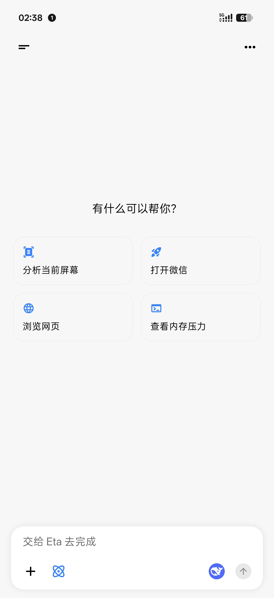
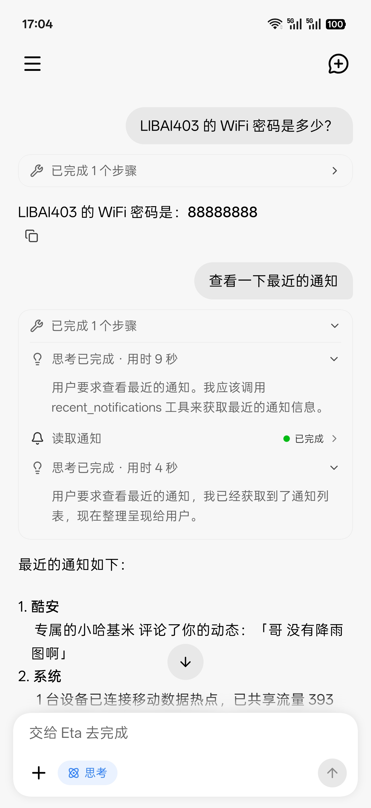
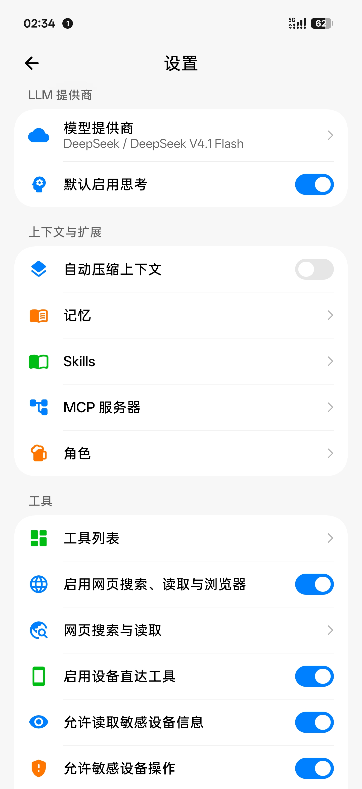
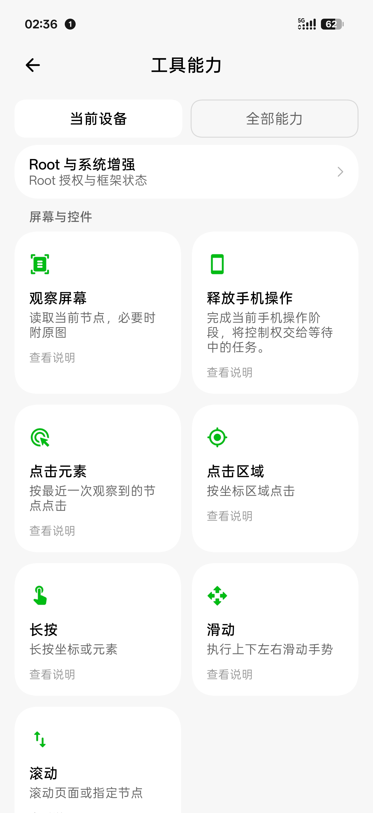
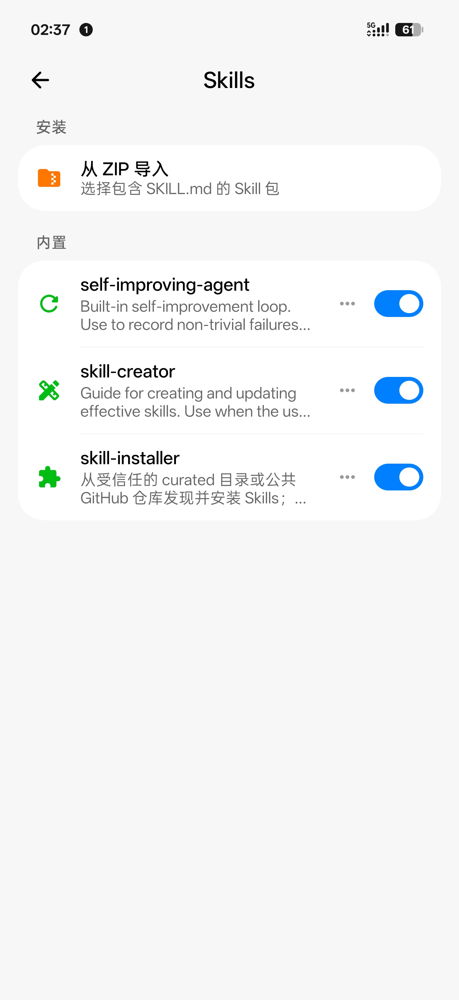

<h1 align="center">Eta</h1>

<strong>简体中文</strong> | <a href="README_EN.md">English</a>

<strong>面向 Android 的第三方系统级 AI Agent（BLACK-BIRTHDAY 专属增强版）</strong>

        

  

Eta 借助 Root 与 LSPosed 越过 App 沙盒，直接进入系统底层：Hook 系统组件，接管电源键与厂商助手入口，读取原厂与第三方应用的私有数据。同时支持普通免 Root 设备运行 Linux PRoot 终端与沙盒。这些接近原厂、又比原厂更自由的能力，全部开放给你自己接入的模型（ChatGPT、Gemini 3.x、DeepSeek、Kimi 等，自带 API Key——BYOK，以及 Codex / Grok 订阅登录）。

> [!TIP]
> 🌟 **本分支专属核心增强速览**
> 1. **💎 Google Gemini 双栈引擎（GenerateContent + Interactions）**：默认直接对接原生 `generateContent` 端点与 Vertex AI 服务账号 JSON，内置彩钻标识，支持 1M 超大上下文 (`gemini-3.8-flash-tiered`)、原生自适应 Thinking 预算控制（对齐 Antigravity Manager / Cherry Studio 精准阶梯）、思考签名兼容与 400 自动重试、多模态生图与 `inlineData` Base64 实时 Markdown 图片渲染，亦可选官方 Interactions API。
> 2. **⚡ 内核管道 Zero-Copy Pipe IPC**：彻底终结 Android 1MB Binder 事务物理限制。会话历史超 32KB 自动切换为 `ParcelFileDescriptor.createPipe()` 内核流式传输，支持高达 2,000,000 字符超长上下文；智能 `user` 轮次原子裁剪边界，杜绝断头 400 语法错误。
> 3. **🌊 ColorOS 16 / Android 16 原生流体云与实时胶囊**：全面接入 Android 16 `POST_PROMOTED_NOTIFICATIONS` 规范与 ColorOS 16 官方实况架构。在 Agent 执行构思思考、代码编辑写入、终端命令测试时，状态栏挖孔旁实时升起动态呼吸胶囊；支持锁屏磨砂卡片、AOD 静态微标、点击以 ColorOS 自由小窗弹出交互，任务完成后 5 秒优雅自动收回。
> 4. **🔀 多会话真正并发与 Subagent 子智能体**：采用官方 `RuntimeRunRegistry`、`GuiControlCoordinator` 与 `subagent` 并发派发架构，支持内置预设（`explore`、`coder`、`plan`）、对话内临时专职角色与自定义模板（`agents/<name>.md`），并融合单次 100 步防死循环软护栏与中断阶段性结果兜底。
> 5. **💳 ColorOS 双击电源键直达钱包**：深度 Hook ColorOS 系统输入分发，双击电源键无论在锁屏还是亮屏状态，瞬间拉起 Google 钱包或一加钱包，支付出行一触即达。

---

不同于仅停留在无障碍模拟点击或通用 Root Shell 的第三方 Agent，Eta 对标的是手机厂商预装的一方系统助手。项目针对 Android 系统服务与厂商一方应用做了大量深度适配，目标是提供真正的**系统级 AI 助手体验**：

- **个人上下文**：直接对接系统 Provider、系统数据库、ColorOS DMP 个性化索引与小布记忆进程内 Hook 桥，按需检索位置、通知历史、应用使用统计、日历、相册（支持图片文字与画面内容检索）、通讯录、短信与验证码、通话记录、录音与转写摘要、便签、健康汇总、剪贴板历史、聊天图片，以及小布记忆、账单与收支汇总、航班/火车/酒店行程、外卖快递订单、待办线索与收藏地点。
- **系统与一方应用操作**：通过 Android API 与一方应用原生接口，直接读写日历日程（单条或批量创建、修改、删除）、管理闹钟（创建、改时、启停、删除）与计时器、创建/读取/回收系统便签，以及控制手电筒、亮度、息屏时间、响铃与勿扰、音量、媒体播放、护眼与深色模式、Wi‑Fi、蓝牙、移动数据、个人热点、NFC、系统设置项与应用冻结，所有状态修改均读回核验。
- **原生数字助理与系统入口**：Eta 自身即为完整的 Android 数字助理应用，长按电源键可直接唤醒 Eta 本体发起任务，唤醒时自动附带当前屏幕原图与结构化应用内容；也可通过 Xposed 接管小布助手与超级小爱。任务执行进度实时同步至顶部状态胶囊与状态栏/锁屏实时活动（Live Updates / 流体云），并支持解锁 Gemini 系统助手与一圈即搜。

Eta 独立实现了 Agent Runtime 与 Agent Loop，统一编排模型调用、工具执行和结果反馈，并支持 Skills 与 MCP 扩展。使用 AI 功能支持自备模型服务的 **API Key（BYOK）**，也支持 **Codex（ChatGPT）与 Grok 订阅账号登录**，模型与服务商由你选择。

支持 **Android 13 及以上版本的 ARM64 设备**，App 本体不限手机品牌，基础功能无需 Root。Root 和 LSPosed 可进一步开放深层个人上下文、一方应用接口与系统助手入口，具体能力取决于授权和 ROM 适配。

[下载 APK](https://github.com/Mangi-11/Eta/releases) · [快速开始](#快速开始) · [为什么做 Eta](#为什么做-eta)

## 界面预览

| GUI Agent | 小布助手 BYOK |
| :-------: | :-----------: |
|  |  |

更多界面：聊天、设备工具与设置

|                  聊天首页                  |                        小布入口执行命令                        |                       系统 API 调用                       |
| :-----------------------------------------: | :------------------------------------------------------------: | :-------------------------------------------------------: |
|  |  |  |

|                  设置                  |                工具能力                |                 Skills                 |
| :------------------------------------: | :-------------------------------------: | :------------------------------------: |
|  |  |  |

## 核心能力

### 执行工具

- **系统与一方应用操作**：直接调用 Android API 与一方应用接口，读写日历日程（支持单条或批量创建、修改、删除）、管理闹钟与计时器、创建和回收系统便签；控制手电筒、亮度、息屏时间、响铃与勿扰、护眼与深色模式、音量、媒体播放，以及 Wi‑Fi、蓝牙、移动数据、个人热点、NFC、定位和省电模式。也可查询应用版本、安装来源与权限，停止或冻结应用，在 Root 授权下筛选系统日志。设置、开关和一方应用写操作都会读回实际状态，未确认时明确报告，不盲目重复执行。
- **GUI Agent**：结合无障碍 UI 树、控件定位与按需截图，执行点击、长按、滑动、滚动和文本输入；动作成功后会自动附带新界面的节点快照，截图按原始尺寸与像素传递，不在上传前缩放或转 JPEG。执行期间保持屏幕常亮，屏幕边缘流光提示正在接管，状态栏下方的状态胶囊显示当前步骤（手势经过时自动让路），点击展开补充、暂停与停止。
- **运行通知**：Android 16 及以上且支持 Live Updates 的系统可在状态栏胶囊与锁屏显示 Agent 任务状态，纯后台任务同样适用；具体展示取决于系统支持和通知设置，部分系统映射到流体云或超级岛。仅驻留的终端会话、Linux 等任务保持普通前台通知。
- **网页搜索与内置浏览器**：提供轻量的公开网页搜索与静态正文分页读取，可在设置中切换内置默认、DeepSeek Search / Fetch 或自定义 HTTP 接口；动态 JavaScript 页面通过内置 WebView 加载，支持读取正文、操作 DOM 与截图，用户可随时打开同一浏览器会话接管。
- **终端**：Android user/root Shell、Alpine / Debian Linux 与脚本执行，支持会话、异步后台命令和常驻守护任务；返回实际 Shell、执行身份与可解析命令的信息。
- **文件工具**：读取、写入、精确编辑、元数据查询、目录分页、路径匹配、文本搜索与本机图片读取。文本读取按 UTF-8 字节边界续读，编辑检查旧内容，搜索结果说明实际范围与未完成部分。

同一项任务可以组合多种工具：例如先读取网页资料，再用脚本整理文件；或汇总近期账单与行程记录后写入日历提醒，从通知和小布记忆中找到取件码与订单线索，再打开应用确认状态。

- **系统 API 调用**：通过 Android API 与系统 Intent 设置闹钟、控制媒体、调整音量、读取设备状态，无需逐步操作界面。
- **GUI Agent**：结合无障碍 UI树、控件定位与按需截图，执行点击、滚动和输入；通过浮层展示执行状态，支持停止和接管。
- **内置浏览器**：通过 WebView 加载 JavaScript 页面、读取正文、操作 DOM 与截图；用户可打开同一浏览器会话接管。
- **终端与文件**：Android user/root Shell、Alpine / Debian Linux、文件读写与脚本执行，支持会话、异步命令和守护任务。

同一项任务可以组合多种工具：例如先读取网页资料，再用脚本整理文件；或从通知中找到订单线索，再打开应用确认状态。

### 上下文与扩展

- **个人上下文**：通过结构化只读工具按需获取本机与厂商 ROM 数据。普通授权下可读取时间与时区、最近位置、设备环境（锁屏、勿扰、音频输出与外接显示状态）、当前通知与最近 7 天通知历史、最近打开应用与前台使用时长，以及日历日程。Root 授权下进一步开放通讯录、通话记录、短信与验证码提取、相册图片（支持按文件名，或通过内容索引按图片 OCR 文字、画面描述与标签检索）、音频与录音、共享文件与下载记录、输入法剪贴板历史、Health Connect 健康汇总（步数、睡眠、运动、心率、体重、血氧）、已保存的 Wi‑Fi 密码及微信/QQ 聊天图片缓存。在 ColorOS 上，还可通过小布记忆进程内 Hook 桥与系统 DMP 索引直接检索小布记忆、便签、通话与普通录音摘要，以及账单与收支汇总、航班/火车/酒店行程、外卖快递订单、待办线索、生活事件和收藏地点。
- **内核管道跨进程通信（Zero-Copy Pipe IPC）**：突破 Android 1MB Binder 事务大小限制，当会话历史超过 32KB 时自动启用 `ParcelFileDescriptor.createPipe()` 流式传输，直通核心 Service；支持高达 2,000,000 字符超大上下文容量，以 `user` 轮次为最小原子边界智能裁剪，彻底杜绝孤立 `model`/`tool` 截断造成的 400 语法错误。
- **长期记忆**：使用本机 `MEMORY.md` 保存跨对话背景，核心内容按预算加入上下文，其余按需读取；支持编辑、清空和关闭。
- **Subagent**：支持在独立子上下文中派发并并发运行多个 Subagent（内置 `explore`、`coder`、`plan`，支持在对话中按需拉起任意临时专职 Subagent 或保存 `agents/<name>.md` 复用模板），可单独配置轻量/高速模型（Secondary Model）并在聊天时间线中点击实时检视内部步骤。
- **Skills**：按需加载任务方法、参考资料与脚本资源，支持公开 GitHub 仓库安装和本地 ZIP 导入；安装不会执行脚本或开启额外权限。
- **MCP**：通过 Streamable HTTP 连接远程工具，支持 Bearer Token；工具逐项启用，与本机工具共同参与任务。
- **会话与结果**：外部入口触发的运行结果归档到 App 会话，进程被杀也会尝试恢复；长按消息可复制、编辑或从该轮删除，最终回复可重新生成。

### Agent Runtime

Agent Runtime 运行在 Eta App 内，来自聊天页面和系统助手的请求共用同一个 Agent Loop。模型通过 Tool Calling 选择工具，执行结果回到上下文，再决定下一步。工具 Schema 用于向模型说明参数，调用交给对应执行器处理，并在执行前检查权限；Hook 进程只负责入口与结果回传。

Runtime 同时管理流式事件、steering、取消和增量 transcript。回复或执行工具期间可以继续输入消息：短按发送排入待发队列，在当前 turn 完成后依次进入下一轮，点击队列胶囊可退回输入框继续编辑；长按发送或点击闪电图标可立即中断当前回合插话。会话与结果在本机归档；中断后尝试恢复已有记录，不自动重放操作。详细设计见 [Agent Runtime](docs/AGENT_RUNTIME.md)。

### 可选角色

侧边栏的“角色”可管理、导入和导出兼容酒馆的 PNG / JSON 角色卡，并从角色开始对话。角色会话仍能调用 Eta 的手机工具，支持用户人设、内嵌世界书和独立剧情记忆；普通对话及系统助手入口保持默认 Eta。角色正文可原位编辑，重新生成只改写回复，不重复执行设备动作。兼容范围和记忆说明见[角色功能](docs/CHARACTERS.md)。

## 独家底层技术解析

### 1. Zero-Copy Pipe 跨进程通信架构（击穿 1MB Binder 限制）

在 Android 系统的底层架构中，跨进程通信（IPC）普遍依赖 Binder 驱动。然而 Binder 驱动拥有著名的物理硬伤——**单个进程所有正在进行的事务共享仅约 1MB 的内存缓冲区**。

当 Agent 在手机上执行复杂的多步任务、累积了数十轮对话、或者输入包含超长终端执行日志与记忆上下文时，传统的 Binder Bundle 序列化极易触发致命的 `TransactionTooLargeException`，导致 Service 进程静默崩溃或断联。

**本增强版的破局方案：内核管道双轨传输机制**
- **双轨自适应**：消息序列化体量 $\le 32\text{KB}$ 时，继续走极速 Bundle 原生传输；一旦序列化字节超过 $32\text{KB}$，底层自动调用 Linux 内核管道 `ParcelFileDescriptor.createPipe()`。
- **零拷贝异步流传输**：客户端利用后台守护线程将 UTF-8 字节流写入管道写入端，并将管道读取端通过 Binder 句柄传给目标 Service；服务端通过 `ParcelFileDescriptor.AutoCloseInputStream` 直接流式消费并解码。
- **200 万超长容量**：会话上下文传输物理上限由原本的 9.6 万字符直接放宽至 **2,000,000 字符**，彻底释放现代大模型的长上下文威力。
- **原子轮次裁剪防 400**：传统裁切算法由于按单条消息削减，极易把对话截断在孤立的 `tool` 或 `model` 消息处，导致发起请求时被大模型 API 判定为非法轮次并返回 400 语法错误。本分支重构了裁剪逻辑，**强制以 `user` 轮次为最小原子边界**，若发生超限压缩，始终保留语法完备的上下文开端。

---

### 2. Google Gemini 3.x 原生协议全要素实战指南

本分支引入了与 OpenAI、Anthropic 并驾齐驱的 Google Gemini 官方原生渠道支持，带来极致的原生特性体验：

- **官方彩钻 Logo 与专属通道**：
  - 位于全局提供商第 2 顺位，原生直连 Google Gemini `v1beta/models/{model}:streamGenerateContent` 端点。
  - **双重智能鉴权**：请求官方端点（`generativelanguage.googleapis.com`）时，自动采用 `x-goog-api-key` 请求头（避免 Bearer 认证被 Google 判定为 `ACCESS_TOKEN_TYPE_UNSUPPORTED`）；请求第三方代理网关（如 One API / New API / 自建反代）时，自动双向附加 `Authorization: Bearer`，无缝兼容任何中转服务。
- **精选预置模型与前向通配**：
  - `gemini-3.8-flash-tiered`：主力对话与 Coding 模型，拥有 **1,048,576 (1M)** 顶级上下文窗口，全面支持多模态输入与原生 Thinking。
  - `gemini-3.1-flash-image` / `gemini-3-pro-image`：官方生图模型，自动加入白名单豁免，免遭文本对话过滤机制误杀。
  - **前向通配规则**：内置 `MODERN_GEMINI_REGEX = Regex("""^gemini-(?:[3-9]|\d{2,})\..*""")`，自动为后续面世的 Gemini 4.x / 5.x 赋予超长窗口与多模态特权，无需等待版本更新。
- **Google 原生 Thinking 思考预算支持**：
  - 支持自适应思考、关闭思考以及分级阶梯控制：
    - `自适应 (Default)`：预算传 `-1`，交由 Google 官方模型自主动态评估思考深度（推荐）。
    - `关闭 (Off)`：预算传 `0`，零等待极速输出。
    - `微念 / Low`：`4096` tokens
    - `斟酌 / Medium`：`16384` tokens
    - `沉思 / High`：`32768` tokens
    - `极致 / Max`：`65535` tokens（严格规避 65536 溢出报错）
- **多模态图像生成与 Markdown 实时渲染**：
  - 对生图模型返回的 `inlineData` 数据结构提供无缝解析，自动将原始 Base64 转换为标准 Markdown 图片语法嵌入消息流中，在聊天界面直接无缝展现精美画作。

---

### 3. ColorOS 双击电源键直达钱包

针对 ColorOS（OPPO / 一加）用户日常高频的刷卡与支付痛点，利用 LSPosed 深度 Hook 系统底层按键分发逻辑：
- 任意状态（**熄屏、锁屏密码界面、桌面或运行任意 App 期间**），只需双击电源键即可瞬间拉起 **Google 钱包** 或 **一加/欢太钱包**。
- 地铁闸机、公交刷卡、便利店闪付不再需要在桌面上翻找 App，抬手即可完成挥卡。

---

### 4. ColorOS 16 / Android 16 原生流体云与实况胶囊深度适配

无需重度反编译 SystemUI 带来系统崩溃隐患，本分支全面打通 Android 16 官方 Live Updates 规范并深度契合 ColorOS 16 潘塔纳尔流体云引擎：
- **官方特权声明**：显式声明 Android 16 全新 `android.permission.POST_PROMOTED_NOTIFICATIONS` 权限，让 Eta 拥有合法资格出现在系统的“流体云显示实时活动”准入清单中。
- **Google Maps 级原生通道参数**：在前台服务运行期间，注入 `setRequestPromotedOngoing(true)`、`FLAG_PROMOTED_ONGOING`（`0x40000`）及 `ProgressStyle` 模板，以 `CATEGORY_NAVIGATION` 唤醒系统最高级别的实况胶囊流。
- **紧凑精细排版与 500ms 阻尼节流**：
  - 胶囊收起态自动呈现精炼动词与核心文件名（例如 `[🧠 构思中]`、`[📝 写入: AuthService.kt (2/5)]`、`[🔨 执行: gradlew]`）。
  - 内置 500ms 阻尼防抖，大阶段（思考/编码/测试）秒级跃迁，耗时阶段平滑更新，绝不引起状态栏帧率抖动。
- **锁屏卡片、自由小窗与优雅退出**：锁屏呈现半透明实时进度卡片；点击胶囊直接以 **ColorOS 自由小窗** 原地呼出 Eta 进行交互与打断；任务成功后 8 秒自动优雅收回。

---

## 为移动设备重新设计的终端

Eta 的终端可以由 Agent 调用，也可以由你直接操作。多个会话各自保留工作目录与环境；PTY 控制台是默认形态，可以直接运行 Claude Code、Codex、Kimi Code 等 TUI：输入直达终端，键条提供 Esc、Ctrl/Alt、方向键、回车与粘贴，网格随软键盘自动调整；简洁模式按命令展示输入输出。模型通过 `terminal` 执行命令，`terminal_job` 管理回复结束后仍会继续执行的后台命令，完成时发送通知并保留日志，`terminal_daemon` 管理可跨任务运行的后台服务；两种后台任务都可查看输出、主动停止。

Agent 的文件与命令共用本次运行的默认身份和工作区：已确认 Root 授权时默认直接使用 Root，否则使用 App 身份；两者使用同一个私有工作区，身份变化不移动文件。工作区页面支持读取、导出 Root 生成的文件；需要普通身份时显式传 identity=user。普通 Shell 身份不等同于 ADB Shell。Linux 文件路径在所选环境内部解析，例如 `/workspace`，不使用 Android 宿主的 rootfs 路径。单次写入及精确编辑限制为 512 KiB；续读、分页、版本检查与不同后端的写入保证见 [文件工具合同](docs/AGENT_RUNTIME.md#结构化文件工具)。

- **Linux 环境**：可选 Alpine 或 Debian，普通设备使用 PRoot，Root 设备还可选择 chroot。两种后端独立安装，不自动迁移数据；PRoot 中的模拟 root 不提供 Android 系统权限。
- **开发工具**：Python、Node.js、SSH、APK 分析与 Kimi Code 按需安装。
- **文件管理**：私有工作区支持导入、导出；已授权的 Android 目录可共享到 Linux 的 `/workspace/mounts/`，也可在 App 内浏览 Linux 文件。通过选择器导入的文件是工作区副本，修改副本不会自动写回来源；文件工具只接受文件系统路径，不直接写回 `content://` 文档。

Eta 本体可以读取项目、修改代码、运行命令并验证结果。如果想在手机上持续进行编程工作，[Kimi Code](https://github.com/MoonshotAI/kimi-code) 的 **Kimi Web** 提供了更适合移动端的 Web UI，可以在浏览器中持续对话、查看代码修改与执行结果，享受完整的 Coding Agent 工作体验，随时随地 Vibe Coding。

在 Eta 中安装 Linux、Node.js 与 Kimi Code 后，即可从首页一键启动 Kimi Web，也可以在终端运行 `kimi`。Kimi 使用独立的模型配置与会话，需单独完成登录或配置；离开页面后可返回继续使用，也可从 Eta 主动停止。

## 模型与 BYOK

使用 Eta 的 AI 功能支持自备模型服务的 **API Key（BYOK）**，也支持 **Codex（ChatGPT）与 Grok 订阅账号登录**。内置 OpenAI、Anthropic、**Google Gemini**、阿里百炼、DeepSeek、Kimi、MiMo、MiniMax、StepFun、硅基流动、OpenRouter 和 xAI 等提供商配置，也可添加自定义服务。

内置 OpenAI 与 xAI 提供商可在填写 API Key 和订阅账号登录之间切换：Codex 通过 PKCE 授权，Grok 通过设备码授权，均由系统浏览器完成登录。登录成功后自动拉取并同步账号可用的远端模型目录、上下文窗口与思考档位；OAuth 凭据经 Android Keystore 加密保存在本机不可备份目录，不进入跨进程通信或备份文件。

内置提供商附带常用对话模型预设；目录更新会为已有内置配置补充新型号，并保留用户的模型设置和当前选择。硅基流动与 OpenRouter 的模型目录变化较快，可在提供商的「模型」页面从服务端拉取。

提供商列表还可从 [models.dev](https://models.dev/) 社区目录挑选兼容的对话服务和模型；联网时更新目录，离线时使用本地缓存或随应用打包的快照。导入后的提供商默认停用，需核对服务地址、填写该服务的 API Key 并启用；Eta 读取目录时不发送已保存的 API Key。

Provider 层支持 OpenAI-compatible Chat Completions、Responses API、Anthropic Messages 以及 Google Gemini 双协议（GenerateContent + Interactions），包括 SSE、Tool Calling、图片输入与推理内容。你可以自定义服务地址、请求头和请求体，拉取或手动添加模型（拉取后从尚未添加的模型中勾选需要的加入），调整上下文长度与思考档位。具体能力取决于模型与接口，部分 Responses 提供商与 Gemini 还可开启服务端网页搜索。

在设置中的模型提供商填写模型的上下文窗口大小（tokens）后才会启用自动压缩，从远端拉取时接口标注了窗口的模型会自动填好；未填写时照常对话，可手动压缩。“设置 → 上下文与扩展 → 自动压缩上下文”默认开启，修改从下一次运行生效，关闭后仍可手动压缩。自动压缩按服务商实际返回的输入用量与该窗口判断，不自动补窗或估算请求 token 数；服务商未返回输入用量时，可手动压缩。

提供商配置中的“自定义请求头”默认折叠，可添加、编辑和删除名称/值，保存后用于模型列表与对话请求；“测试连接”会使用尚未保存的配置。支持覆盖 `User-Agent`，认证和传输请求头仍由 Eta 管理。连接 OpenCode 官方端点时，Eta 自动发送每段对话稳定的 `x-opencode-session`，无需手动填写；默认客户端标识为 `Eta`。

## 系统助手入口

- **ColorOS 双击电源键直达钱包**：深度 Hook ColorOS 系统输入分发，双击电源键无论在锁屏还是亮屏状态，瞬间拉起 Google 钱包或一加钱包。
- **长按电源键路由**：在设置中选择长按电源键唤起 Eta 本体、Gemini 或系统默认助手。
- **Eta 原生数字助理**：从电源键直接唤起 Eta 本体全局浮窗，竖屏下光效从按键位置沿屏幕边缘进入并汇聚到底部，支持语音提问、切换键盘输入或点击建议提问，上拉浮窗即可回到 Eta 主界面接管当前会话；唤醒时由系统直接提供当前屏幕截图与应用内容，无需额外点击或开启无障碍截图。语音识别可选择系统服务、千问或豆包，也可在设置中独立关闭语音识别以直接弹出文字输入栏与键盘；云端模式只需麦克风权限与对应服务配置，不依赖设备自带识别服务。语音播报支持千问、豆包、Gemini 和 MiniMax，可配置音色并试听，支持助手回答自动播报、聊天听写以及手动/自动朗读（退到后台或锁屏可继续播放），详见[语音配置](docs/VOICE.md)。
- **小布 / 超级小爱接管**：习惯使用厂商原有入口时，也可保留小布或超级小爱的界面，将请求交由 Eta 本体与自选模型处理。

- **Eta 原生数字助理**：从电源键直接唤起 Eta 本体全局浮窗，竖屏下光效从按键位置沿屏幕边缘进入并汇聚到底部，支持语音提问、切换键盘输入或点击建议提问，上拉浮窗即可回到 Eta 主界面接管当前会话；唤醒时由系统直接提供当前屏幕截图与应用内容，无需额外点击或开启无障碍截图。语音识别可选择系统服务、千问或豆包，也可在设置中独立关闭语音识别以直接弹出文字输入栏与键盘；云端模式只需麦克风权限与对应服务配置，不依赖设备自带识别服务。语音播报支持千问、豆包、Gemini 和 MiniMax，可配置音色并试听，支持助手回答自动播报、聊天听写以及手动/自动朗读（退到后台或锁屏可继续播放），详见[语音配置](docs/VOICE.md)。
- **长按电源键路由**：在设置中选择长按电源键唤起 Eta 本体、Gemini 或系统默认助手。
- **小布 / 超级小爱接管**：习惯使用厂商原有入口时，也可保留小布或超级小爱的界面，将请求交由 Eta 本体与自选模型处理。

在锁死默认数字助理或电源键逻辑的 ROM 上，电源键路由与厂商助手接管需要 LSPosed 与对应系统支持。

## 解锁 Gemini 与一圈即搜

- **Gemini 解锁**：补齐 Gemini 系统助手能力，支持 Google App 系统化、锁屏与亮屏语音输入、息屏热词补偿。
- **一圈即搜**：解锁一圈即搜，通过手势条长按或双指识屏触发。

需要 LSPosed 与对应系统支持，具体功能与适配说明见[技术实现](docs/TECHNICAL.md)。

## 权限与数据边界

系统工具、敏感读取、敏感操作、终端与文件、网页浏览、记忆均有独立开关，当前默认开启。Runtime 在执行前重新检查权限，撤权或断连不会覆盖已保存的配置。

- **数据去向**：任务所需的对话、图片和工具结果会发送给配置的模型服务；本地 Runtime 不代表本地推理。自定义 HTTP 地址会明文传输 API Key 与请求内容。
- **本机记录**：敏感工具及 MCP 的原始参数、结果不写入持久会话，模型回复仍会保存。通知历史在授权后保存最近 7 天、最多 1000 条；MCP 认证令牌、网页工具独立密钥与提供商 OAuth 凭据均通过 Android Keystore 加密保存。
- **会话模型**：每个对话记住上次使用的模型，切回对话即恢复；在对话中切换模型同时更新默认模型，新对话与系统助手入口使用默认模型。原模型被停用或删除时临时改用默认模型并提示，重新启用后自动恢复。
- **会话与备份**：打开对话先显示最近消息，向上翻阅时自动加载更早记录并保持阅读位置，搜索和导出仍覆盖完整记录。支持消息复制、编辑、从某轮删除和回复重新生成；单个对话可导出为 Markdown，也可整体导入导出对话、模型配置、角色资料与记忆；备份包含 API Key，不包含订阅登录的 OAuth 令牌。分享角色卡只导出角色设定和卡片图片，不包含私人对话与记忆。
- **运行边界**：任务可停止或接管。后台运行受 Android 与厂商进程管理影响，强停或重启后需手动启动；系统与应用更新也可能需要重新适配 Hook。

## 快速开始

1. 从 [Releases](https://github.com/Mangi-11/Eta/releases) 下载 APK，安装后在“模型提供商”中填写 API Key（或登录 Codex / Grok 订阅账号）并选择默认模型。执行任务需要 Tool Calling，理解图片还需模型支持图片输入。
2. 按任务需要配置工具开关与权限：GUI Agent 需要无障碍服务；日历读写、通知、应用使用情况分别授权；位置工具需要“始终允许”。工具页可查看当前设备的可用能力。
3. 开始对话。需要 Linux 时，在“Linux 工具环境”中安装发行版、基础工具及所需开发工具；需要系统入口时，参见[系统助手入口](#系统助手入口)。

- **普通设备**：Android 13+ ARM64 设备，可使用聊天、网页搜索与内置浏览器、记忆、Skills、MCP、普通终端与私有工作区；日历读写、GUI 和本机通知/位置/使用情况读取按需授权。
- **Root 设备**：进一步开放系统设置与开关修改、应用管理、受保护文件、系统与厂商个人数据深度检索、一方应用（闹钟、便签等）原生操作，以及 Root Shell 和 chroot。
- **LSPosed 与适配 ROM**：开放厂商助手接管、系统快捷入口、小布记忆进程内查询桥及 Google 能力增强；部分功能另需 Root。

联系人、短信、通话记录、系统索引与厂商应用私有数据等专用检索目前仍需要 Root（日历读写已支持普通 Android 日历权限）。完整条件与验证范围见[设备支持说明](docs/ROOTLESS_SUPPORT.md)。

## 为什么做 Eta

### 从不好用的手机助手开始

做 Eta 的起点很直接：我觉得很多手机厂商的 AI 助手不好用。回答不够准确，稍复杂的需求就需要自己接着操作。我最早想解决的只是屏幕问答：刷到一个陌生概念，就在当前屏幕上问清楚，让模型结合内容搜索、解释，省去复制文字、切换应用和重新描述背景的过程。

这样的体验很依赖模型能力。模型迭代很快，我希望手机助手也能及时用上更好的模型。因此，我把自选模型作为 Eta 的基础能力，让用户保留熟悉的手机入口，用自己选择的模型问答和执行任务。

### 桌面 Agent 百花齐放，手机 AI 却处处碰壁

桌面端有完整的 Shell 环境、成熟的命令行工具和开放的文件系统。模型在用户权限范围内，可以读写文件、安装依赖、执行程序，把现有工具组合起来完成各种任务。这给了 Agent 充分的发挥空间，也是 Coding Agent 能在桌面端百花齐放的重要原因。

Android 虽然也有 Shell，但普通 App 能访问的目录、系统能力和执行环境都受到较多限制。补上一套 Linux 环境可以解决命令与依赖，手机里的应用和数据却仍然隔着一道墙。许多服务封闭在各自的 App 中，没有供 Agent 直接调用的接口，系统助手也很难把它们串起来。

这也是我对手机 AI 最不满意的地方。大模型已经迭代了几年，桌面端的工作方式不断变化，手机上的很多 AI 体验却依然停留在问答、摘要和几个预设场景里。功能越来越多，真正改变使用方式的产品却不多；一到跨应用、跨服务的任务，用户还是要自己接着做。

豆包手机助手让我看到了不同的可能。它以豆包 App 为基础，与手机厂商在操作系统层面合作，让 AI 理解屏幕并执行跨应用任务。但这样的尝试很快碰到了生态边界：2025 年 12 月，部分用户遇到微信异常退出和登录限制，豆包随后下线了操作微信的能力；同期还有淘宝人机验证、银行 App 要求关闭屏幕共享的反馈。微信方面当时表示，可能触发了原有安全风控。

同月，豆包还宣布限制刷激励、金融应用和部分游戏场景。在我看来，这些事件说明，即使拿到系统级权限，也很难独自打通应用生态。App 将账号、数据、服务和交易留在自己的闭环里，手机厂商也有各自的设备与服务生态。Agent 改变了用户入口和服务分发方式，接口能否开放，同时涉及技术、安全和商业选择。

我能理解手机厂商在商业合作和生态之间的顾虑，但这不该成为 AI 助手不好用的借口。跨应用能力暂时受限，至少也应该提供一个理解到位、回答可靠的模型，或者让用户接入自己选择的模型。

### 把 Agent 装进手机之后

把 OpenClaw（“龙虾”）或桌面 Coding Agent 搬进手机的 Linux 环境，可以让它继续处理文件、运行脚本。但如果接不到手机的系统能力和个人上下文，它仍是一只困在沙盒里的龙虾；即便授予无障碍或 Root Shell 权限，若缺少对系统与厂商 ROM 的适配，模型依然难以直接获取本机结构化数据或调用一方应用接口。运行环境迁移之后，手机上的应用、数据和系统入口仍要逐一接通。

我既是第三方开发者，也是 Android 玩机用户，没有预装合作和自有生态的商业包袱，所以愿意在系统适配上做得更激进一些，尽可能把手机已有的能力开放给用户自己选择的模型。

Eta 在这一层做适配：通过 Xposed 接管小布、超级小爱和电源键入口，直接调用系统与一方应用接口操作日历、闹钟、便签和系统开关，并检索通知、相册、健康数据以及小布记忆、账单、行程、订单、录音摘要等本机数据源。Shell 与 Linux 提供计算环境，GUI Agent 覆盖缺少接口的应用操作。这些能力共用同一套 Agent Runtime，让模型既能了解手机上的事情，也有工具把事情做下去。

我也不认为每件事都值得交给 AI。几次点击就能完成的操作，如果要多花时间、支付调用费用，还得盯着模型纠错，我宁愿自己动手。我更期待它帮我处理需要结合本机信息、跨应用重复操作，或不方便手动完成的任务。手机 Agent 的价值取决于对系统能力、本机数据和移动交互的理解与适配，功能数量本身不足以说明产品是否好用。

### 对 AI 手机与 Agentic OS 的展望

> 以下是长期愿景，部分能力尚未在 Eta 中实现。

GUI 是为人设计的，通过层层菜单把模糊需求变成具体操作。对模型而言，直接调用 API、CLI、MCP 等接口更友好，能减少截图、控件识别和页面变化带来的开销与错误。GUI Agent 用来补齐没有开放接口的场景。

我期待的 Agentic OS 中，操作系统会成为用户表达需求的第一入口。用户说出目标，系统结合当前情境理解意图，通过 Agent Runtime 选择模型、调用工具、检查结果。过去由用户在不同应用和菜单之间串起的步骤，可以交给系统组织。

App 在其中的角色也会改变：它们继续提供专业功能和服务，同时成为 Agent 可以调用的资源。一次任务可以组合多个应用的能力，结果由系统统一呈现，用户在需要时进入具体界面查看或接管。这样的变化也涉及入口和服务分发，需要应用生态共同开放。

个人上下文、记忆和任务状态则应随用户跨设备延续。例如，在手机上规划好出行，上车后车机就能理解目的并接续导航，无需重新交代背景。手机、电脑、汽车和眼镜可以共享同一个个人 Agent 的记忆，利用各自的感知与执行能力协作。语音、视觉和动作进一步拓展交互方式，让设备在合适的时机主动响应，逐步把 Agent 的能力延伸到物理世界。

Eta 先从现有 Android 上的模型、上下文与工具做起。真正落地到手机上的 Agentic OS，还需要手机厂商、Android 应用开发者、模型服务商与硬件生态共同推进；技术要成熟，接口要开放，各方利益也要协调，完整形态仍然遥遥无期。

## 深入了解

- [设备支持与权限边界](docs/ROOTLESS_SUPPORT.md)：普通设备、Root、文件工作区与后台运行。
- [技术实现](docs/TECHNICAL.md)：设备工具、数据检索、浏览器、终端与系统集成。
- [Agent Runtime](docs/AGENT_RUNTIME.md)：Agent Loop、Provider、steering、transcript 与结果恢复。
- [HyperOS 系统入口](docs/HYPEROS_SYSTEM_ENTRY.md)：电源键、一圈即搜的适配条件与验证边界。
- [终端原生组件](docs/TERMINAL_NATIVE.md)：PTY、PRoot 及随包源码的构建方式。

## Star History

  <a href="https://www.star-history.com/#Mangi-11/Eta&amp;Date">
    <picture>
      <source media="(prefers-color-scheme: dark)" srcset="https://api.star-history.com/svg?repos=Mangi-11/Eta&amp;type=Date&amp;theme=dark">
      
    </picture>
  </a>

## 参考与致谢

- [Pi Coding Agent](https://github.com/earendil-works/pi)：Eta Agent Runtime 的核心参考，包括 Agent Loop、Tool Calling、steering 与 transcript 状态管理。
- [OmniBot](https://github.com/omnimind-ai/OmniBot)：Android AI Agent 方向的参考项目。
- [libxposed API](https://github.com/libxposed/api)：现代 Xposed API。
- [Miuix](https://github.com/compose-miuix-ui/miuix)：UI 组件库。

## 许可证

Eta 采用 [PolyForm Noncommercial License 1.0.0](LICENSE)，未经[作者](https://github.com/Mangi-11)书面授权，禁止个人二次分发、贩卖、收费代装及其他商业使用。

社区：<a href="https://linux.do">LINUX DO</a>
